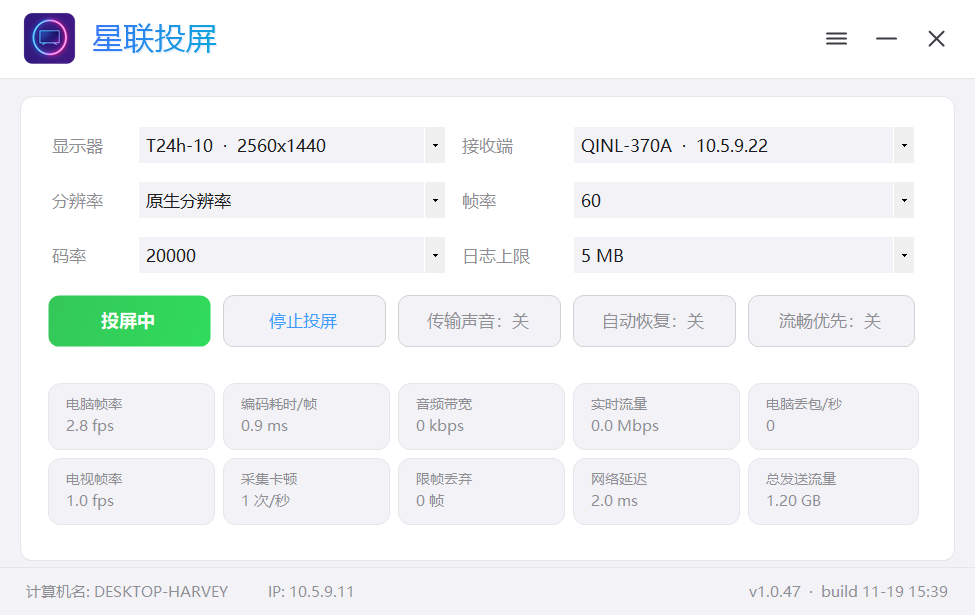

# 星联投屏 · XingLianCast

**把 Windows 电脑画面，投到同局域网的华为智慧屏 / Android 电视上。**
不需要账号、不需要外网、不需要投屏器 —— 只要两台设备在同一个局域网。

## 核心特性

| 特性 | 说明 |
|---|---|
| **支持 4K 画面** | 分辨率可选原生 4K / 1440p / 1080p / 720p，按电视能力自选 |
| **60 fps 低延迟** | 硬件编码 + 局域网直连，延迟约 1~2 帧 |
| **无需联网** | 全程局域网 UDP，不经过任何服务器 |
| **免登录** | 装完即用，没有任何账号体系 |
| **声音同步** | 可选传输电脑声音（AAC 128kbps） |
| **自适应** | 电视解码吃紧时可选「流畅优先」自动降帧/降码率 |
| **稳定** | 断线自动重连、电视端解码器自愈、静止画面持续补帧 |

## 下载

👉 **[下载最新版本](https://github.com/xujinq-023/xingliancast/releases/latest)**

| 文件 | 用途 |
|---|---|
| `XingLianCast-Setup-x.y.z.exe` | Windows 安装包（推荐） |
| `XingLianCast-Portable-x.y.z.zip` | 免安装便携版 |
| `receiver-tv.apk` | 电视端 App（Android 7.0+） |

安装与使用：见 [快速开始](docs/快速开始.md) 与 [使用手册](docs/使用手册.md)。

## 价格

| 版本 | 价格 | 说明 |
|---|---|---|
| 试用 | 免费 | 每天 5 分钟，功能完整 |
| 年付 | **10 元 / 年** | 单台电脑授权 |
| 终生 | **58 元** | 单台电脑授权，永久可用 |

购买方式见 [价格与购买](pricing/价格与购买.md)。

## 系统要求

- **电脑**：Windows 10 / 11（64 位），支持硬件 H.264 编码的显卡
- **电视**：Android 7.0 及以上（Android TV、国产安卓电视、安卓盒子）
- **网络**：两台设备在**同一局域网**，有线、无线均可

> 三星 Tizen、LG webOS、Apple TV 不是 Android 系统，无法安装电视端。

## 联系

- 邮箱：**xujinq@hotmail.com**
- 微信（扫码添加，备注「投屏」）：

## 版权

Copyright © 2026 星联投屏. 保留所有权利。
详见 [LICENSE](LICENSE)。
